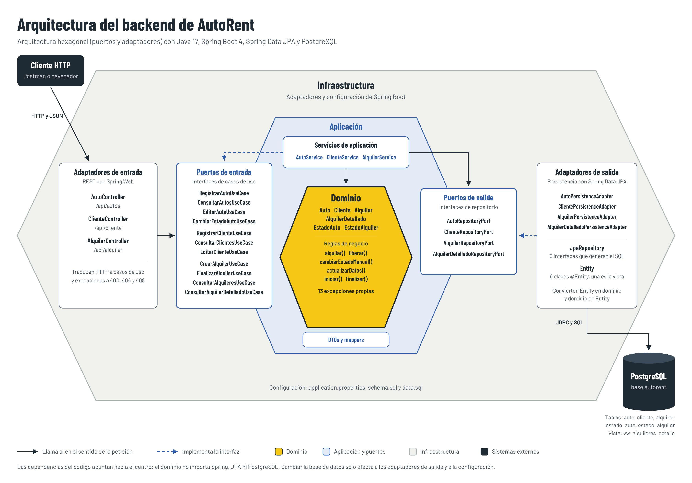

# AutoRent: sistema de alquiler de autos

Backend para gestionar el alquiler de vehículos, desarrollado con **Java 17 y Spring Boot**, aplicando **arquitectura hexagonal (puertos y adaptadores)** y **PostgreSQL** como base de datos.

> Proyecto de clase de Programación Web Backend (UPCA)
> Docente: Ing. Iván Devia Acosta

---

## Integrantes

| Nombre | Rol |
|---|---|
| Kevin Osorio | Desarrollador |

---

## Objetivo

Permitir que una empresa de alquiler de autos controle:

- Qué vehículos tiene y cuáles están disponibles.
- Qué clientes están registrados.
- Cuándo inicia y finaliza cada alquiler.
- Cuánto debe pagar cada cliente.

El sistema está construido para que la tecnología externa (REST, PostgreSQL) pueda cambiar **sin modificar las reglas de negocio**.

---

## Tecnologías utilizadas

| Tecnología | Uso |
|---|---|
| Java 17 | Lenguaje principal |
| Spring Boot 4.1 | Framework base |
| Spring Web MVC | Adaptador de entrada (controllers REST) |
| Spring Data JPA | Adaptador de salida (persistencia) |
| PostgreSQL | Base de datos relacional |
| Driver JDBC de PostgreSQL | Conexión entre JPA y PostgreSQL |
| Lombok | Getters, setters y builders del modelo |
| Maven (wrapper `mvnw`) | Compilación y dependencias |

> El enunciado propone H2. Este proyecto usa PostgreSQL para que los datos se conserven entre ejecuciones. Gracias a la arquitectura, el cambio solo afectó a la configuración y a la capa de persistencia; el dominio y los casos de uso no cambiaron.

---

## Cómo ejecutar el proyecto

### Requisitos

- JDK 17 o superior.
- PostgreSQL 14 o superior (instalado o en Docker).
- No hace falta instalar Maven: el proyecto trae el wrapper `mvnw`.

### 1. Clonar el repositorio

```bash
git clone https://github.com/KevinOsorioDEV/autorent.git
cd autorent
```

### 2. Crear la base de datos y sus tablas

El proyecto usa `spring.jpa.hibernate.ddl-auto=none`, así que Hibernate no crea las tablas. Se crean con los scripts incluidos:

```bash
psql -U postgres -c "CREATE DATABASE autorent;"
psql -U postgres -d autorent -f src/main/resources/schema.sql
psql -U postgres -d autorent -f src/main/resources/data.sql
```

- `schema.sql` crea las tablas `estado_auto`, `estado_alquiler`, `auto`, `cliente` y `alquiler`, y la vista `vw_alquileres_detalle`.
- `data.sql` inserta los estados `DISPONIBLE`, `ALQUILADO`, `MANTENIMIENTO`, `ACTIVO` y `FINALIZADO`. Deben existir antes de registrar autos o alquileres.

Los dos scripts se pueden ejecutar varias veces sin duplicar datos. Si prefieres que Spring los ejecute en cada arranque, agrega esta línea a `application.properties`:

```properties
spring.sql.init.mode=always
```

> En Windows, si `psql` no está en el PATH, abre los scripts en pgAdmin (Query Tool) y ejecútalos sobre la base `autorent`.

**Alternativa con Docker:**

```bash
docker run --name autorent-db -e POSTGRES_DB=autorent -e POSTGRES_PASSWORD=postgres -p 5432:5432 -d postgres:16
docker exec -i autorent-db psql -U postgres -d autorent < src/main/resources/schema.sql
docker exec -i autorent-db psql -U postgres -d autorent < src/main/resources/data.sql
```

### 3. Configurar la conexión

En `src/main/resources/application.properties`, ajusta el usuario y la contraseña de tu PostgreSQL:

```properties
spring.application.name=autorent
spring.datasource.url=jdbc:postgresql://localhost:5432/autorent
spring.datasource.username=postgres
spring.datasource.password=TU_CONTRASEÑA
spring.jpa.hibernate.ddl-auto=none
spring.jpa.properties.hibernate.dialect=org.hibernate.dialect.PostgreSQLDialect
```

### 4. Ejecutar

```bash
# Linux o macOS
./mvnw spring-boot:run

# Windows
mvnw.cmd spring-boot:run
```

La API queda disponible en **http://localhost:8080**.

### Verificar los datos en PostgreSQL

```sql
SELECT * FROM auto;
SELECT * FROM cliente;
SELECT * FROM alquiler;
SELECT * FROM vw_alquileres_detalle;
```

---

## Arquitectura

El proyecto implementa **arquitectura hexagonal**. El núcleo (dominio y aplicación) no conoce los detalles de REST ni de PostgreSQL. Los adaptadores se conectan al núcleo mediante **puertos**, que son interfaces.

### Diagrama de arquitectura



Versión vectorial: [`docs/arquitectura.svg`](docs/arquitectura.svg)

- **Flechas continuas:** sentido de una petición, desde el cliente HTTP hasta PostgreSQL.
- **Flechas discontinuas:** "implementa". Los servicios implementan los puertos de entrada y los adaptadores de persistencia implementan los puertos de salida. Por eso las dependencias del código apuntan hacia el centro.

### Responsabilidad de cada capa

| Capa | Qué contiene | Responsabilidad | Depende de |
|---|---|---|---|
| **Dominio** | `Auto`, `Cliente`, `Alquiler`, `AlquilerDetallado`, enums de estado, excepciones | Entidades y reglas de negocio | Nada (Java puro con Lombok) |
| **Puertos de entrada** | `*UseCase` | Operaciones que ofrece la aplicación | Dominio |
| **Servicios de aplicación** | `AutoService`, `ClienteService`, `AlquilerService` | Implementan los casos de uso y coordinan el flujo | Puertos de salida y dominio |
| **Puertos de salida** | `*RepositoryPort` | Operaciones que la aplicación necesita del exterior | Dominio |
| **Adaptadores de entrada** | `*Controller` | Reciben HTTP, llaman a los casos de uso y traducen excepciones a códigos HTTP | Puertos de entrada |
| **Adaptadores de salida** | `*PersistenceAdapter`, `*JpaRepository`, `*Entity` | Implementan los puertos con Spring Data JPA y PostgreSQL | Puertos de salida |

### Estructura de paquetes

```
com.autorent
├── domain
│   ├── model        Auto, Cliente, Alquiler, AlquilerDetallado, EstadoAuto, EstadoAlquiler
│   └── exception    13 excepciones de negocio (AutoNoDisponibleException, AlquilerFinalizadoException, ...)
│
├── application
│   ├── port
│   │   ├── input    RegistrarAutoUseCase, ConsultarAutosUseCase, EditarAutoUseCase,
│   │   │            CambiarEstadoAutoUseCase, RegistrarClienteUseCase, ConsultarClientesUseCase,
│   │   │            EditarClienteUseCase, CrearAlquilerUseCase, FinalizarAlquilerUseCase,
│   │   │            ConsultarAlquileresUseCase, ConsultarAlquilerDetalladoUseCase
│   │   └── output   AutoRepositoryPort, ClienteRepositoryPort,
│   │                AlquilerRepositoryPort, AlquilerDetalladoRepositoryPort
│   ├── service      AutoService, ClienteService, AlquilerService, Validaciones
│   └── dto
│       ├── request  CrearAutoRequest, CrearClienteRequest, CrearAlquilerRequest, CambiarEstadoAutoRequest
│       ├── response AutoResponse, ClienteResponse, AlquilerResponse, ApiErrorResponse, ...
│       └── mapper   AutoMapper, ClienteMapper, AlquilerMapper, AlquilerDetalladoMapper
│
└── infrastructure
    └── adapter
        ├── input/rest                 AutoController, ClienteController, AlquilerController
        └── output/persistence
            ├── adapter                AutoPersistenceAdapter, ClientePersistenceAdapter,
            │                          AlquilerPersistenceAdapter, AlquilerDetalladoPersistenceAdapter
            ├── repository             6 interfaces *JpaRepository
            └── entity                 AutoEntity, ClienteEntity, AlquilerEntity, EstadoAutoEntity,
                                       EstadoAlquilerEntity, AlquilerDetalladoEntity (vista)
```

Spring registra los servicios con `@Service` y los adaptadores y mappers con `@Component`. Los controllers reciben las **interfaces** de los casos de uso, no las clases de los servicios.

### Separación entre dominio y persistencia

Las clases del dominio no tienen anotaciones de JPA ni de Spring. Las entidades de persistencia (`*Entity`) viven en la infraestructura, y cada adaptador de persistencia convierte de entidad a dominio y viceversa. Los estados se guardan en las tablas `estado_auto` y `estado_alquiler`, cuya columna `descripcion` coincide con los nombres de los enums.

### Flujo de `POST /api/alquiler`

```
Cliente HTTP
   ↓
AlquilerController                       adaptador de entrada
   ↓
CrearAlquilerUseCase                     puerto de entrada
   ↓
AlquilerService                          aplicación (@Transactional)
   ├─► ClienteRepositoryPort  → ClientePersistenceAdapter  → ClienteJpaRepository  → PostgreSQL
   │      verifica que el cliente exista
   ├─► AutoRepositoryPort     → AutoPersistenceAdapter     → AutoJpaRepository     → PostgreSQL
   │      busca el auto y verifica que esté DISPONIBLE
   ├─► calcula valorTotal = precioPorDia × cantidadDias y pasa el auto a ALQUILADO
   ├─► AutoRepositoryPort.guardar(auto)                                           (UPDATE de auto)
   └─► AlquilerRepositoryPort → AlquilerPersistenceAdapter → AlquilerJpaRepository → PostgreSQL
          guarda el alquiler en estado ACTIVO                                      (INSERT de alquiler)
   ↓
AlquilerMapper → AlquilerResponse → 201 Created
```

Qué ocurre con cada entidad:

- **Cliente:** solo se consulta para verificar que existe.
- **Auto:** se consulta, se valida que esté `DISPONIBLE` y pasa a `ALQUILADO`.
- **Alquiler:** se crea en estado `ACTIVO`, con `fechaFin = fechaInicio + cantidadDias` y el `valorTotal` calculado por el sistema.

El método es transaccional: si falla cualquier paso, no queda un auto marcado como alquilado sin su alquiler.

---

## Modelo de datos

### Tablas en PostgreSQL

| Tabla | Columnas |
|---|---|
| `auto` | `id`, `placa` (única), `marca`, `modelo`, `anio`, `deposito`, `precio_dia`, `estado_id` → `estado_auto` |
| `cliente` | `id`, `nombre`, `documento` (único), `email` (único), `telefono` |
| `alquiler` | `id`, `cliente_id` → `cliente`, `auto_id` → `auto`, `fecha_inicio`, `fecha_fin`, `cantidad_dias`, `valor_total`, `estado_id` → `estado_alquiler` |
| `estado_auto` | `id`, `descripcion`: `DISPONIBLE`, `ALQUILADO`, `MANTENIMIENTO` |
| `estado_alquiler` | `id`, `descripcion`: `ACTIVO`, `FINALIZADO` |
| `vw_alquileres_detalle` (vista) | Alquiler unido con el nombre y documento del cliente, la placa del auto y la descripción del estado |

### Entidades del dominio

| Entidad | Campos |
|---|---|
| `Auto` | `id`, `placa`, `marca`, `modelo`, `anio`, `deposito`, `precioPorDia`, `estado` |
| `Cliente` | `id`, `nombre`, `documento`, `email`, `telefono` |
| `Alquiler` | `id`, `clienteId`, `autoId`, `fechaInicio`, `fechaFin`, `cantidadDias`, `valorTotal`, `estado` |

---

## Reglas de negocio

1. **Solo se pueden alquilar autos disponibles.** Un auto `ALQUILADO` o en `MANTENIMIENTO` no se puede alquilar.
2. **Al crear un alquiler, el auto pasa de `DISPONIBLE` a `ALQUILADO`** y el alquiler queda `ACTIVO`.
3. **El valor total lo calcula el sistema:** `valorTotal = precioPorDia × cantidadDias`. El cliente nunca lo envía.
4. **La cantidad de días debe ser mayor que cero.**
5. **Al finalizar un alquiler, el auto vuelve a `DISPONIBLE`.**
6. **No se puede finalizar dos veces el mismo alquiler.**
7. **Cambio manual de estado:** un auto puede pasar de `DISPONIBLE` a `MANTENIMIENTO` y volver. Un auto `ALQUILADO` solo cambia al finalizar su alquiler, y ningún auto se puede marcar como `ALQUILADO` a mano.
8. **Edición de autos:** no se puede editar un auto `ALQUILADO`. La edición no cambia el estado.
9. **Edición de clientes:** no se puede editar un cliente con un alquiler `ACTIVO`.
10. **Datos únicos:** la placa, el documento y el email no se pueden repetir, ni al registrar ni al editar.
11. **Todo auto nuevo entra como `DISPONIBLE`.**

Las reglas que dependen del estado viven en el dominio y los servicios las invocan: `Auto.cambiarEstadoManual()`, `Auto.actualizarDatos()`, `Auto.liberar()` y `Alquiler.finalizar()`.

### Validaciones

| Entidad | Validaciones |
|---|---|
| **Auto** | Placa, marca y modelo obligatorios; depósito y precio por día mayores que cero; placa única |
| **Cliente** | Nombre, documento, email y teléfono obligatorios; email con formato válido; documento y email únicos |
| **Alquiler** | `clienteId` y `autoId` obligatorios; cliente y auto existentes; auto disponible; días mayores que cero |

Antes de guardar se quitan los espacios al inicio y al final de los textos, y el email se guarda en minúsculas. Así `" 123"` y `"123"` cuentan como el mismo documento.

---

## Endpoints

### Autos (`/api/autos`)

| Método | Ruta | Descripción |
|---|---|---|
| `POST` | `/api/autos` | Registrar un auto |
| `GET` | `/api/autos` | Listar todos los autos |
| `GET` | `/api/autos/{id}` | Consultar un auto por id |
| `GET` | `/api/autos/disponibles` | Listar los autos disponibles |
| `PUT` | `/api/autos/{id}` | Editar los datos de un auto |
| `PUT` | `/api/autos/{id}/estado` | Cambiar el estado entre `DISPONIBLE` y `MANTENIMIENTO` |

### Clientes (`/api/cliente`)

| Método | Ruta | Descripción |
|---|---|---|
| `POST` | `/api/cliente` | Registrar un cliente |
| `GET` | `/api/cliente` | Listar todos los clientes |
| `GET` | `/api/cliente/{id}` | Consultar un cliente por id |
| `PUT` | `/api/cliente/{id}` | Editar los datos de un cliente |

### Alquileres (`/api/alquiler`)

| Método | Ruta | Descripción |
|---|---|---|
| `POST` | `/api/alquiler` | Crear un alquiler |
| `GET` | `/api/alquiler/{id}` | Consultar un alquiler por id |
| `PUT` | `/api/alquiler/{id}/finalizar` | Finalizar un alquiler |
| `GET` | `/api/alquiler/detallados` | Listar los alquileres con datos del cliente y del auto |
| `GET` | `/api/alquiler/{id}/detallado` | Consultar un alquiler con datos del cliente y del auto |

---

## Ejemplos de solicitudes y respuestas

### 1. Registrar un auto

**Solicitud:** `POST /api/autos`

```json
{
  "placa": "ABC123",
  "marca": "Toyota",
  "modelo": "Corolla",
  "anio": 2025,
  "deposito": 500000,
  "precioPorDia": 150000
}
```

**Respuesta:** `201 Created`

```json
{
  "id": 1,
  "placa": "ABC123",
  "marca": "Toyota",
  "modelo": "Corolla",
  "anio": 2025,
  "deposito": 500000.0,
  "precioPorDia": 150000.0,
  "estado": "DISPONIBLE"
}
```

### 2. Consultar un auto

**Solicitud:** `GET /api/autos/1`

**Respuesta:** `200 OK`, con el mismo formato del ejemplo anterior.

### 3. Cambiar el estado de un auto

**Solicitud:** `PUT /api/autos/1/estado`

```json
{
  "estado": "MANTENIMIENTO"
}
```

**Respuesta:** `200 OK`, con el auto y `"estado": "MANTENIMIENTO"`.

### 4. Registrar un cliente

**Solicitud:** `POST /api/cliente`

```json
{
  "nombre": "Carlos Pérez",
  "documento": "123456789",
  "email": "carlos@email.com",
  "telefono": "3001234567"
}
```

**Respuesta:** `201 Created`

```json
{
  "id": 1,
  "nombre": "Carlos Pérez",
  "documento": "123456789",
  "email": "carlos@email.com",
  "telefono": "3001234567"
}
```

### 5. Editar un cliente

**Solicitud:** `PUT /api/cliente/1`, con el mismo cuerpo del registro y los datos nuevos.

**Respuesta:** `200 OK`, con el cliente actualizado.

### 6. Crear un alquiler

**Solicitud:** `POST /api/alquiler`

```json
{
  "clienteId": 1,
  "autoId": 1,
  "cantidadDias": 5
}
```

**Respuesta:** `201 Created`

```json
{
  "id": 1,
  "clienteId": 1,
  "autoId": 1,
  "fechaInicio": "2026-10-28",
  "fechaFin": "2026-11-02",
  "cantidadDias": 5,
  "valorTotal": 750000.0,
  "estado": "ACTIVO"
}
```

### 7. Finalizar un alquiler

**Solicitud:** `PUT /api/alquiler/1/finalizar`

**Respuesta:** `200 OK`

```json
{
  "id": 1,
  "clienteId": 1,
  "autoId": 1,
  "fechaInicio": "2026-10-28",
  "fechaFin": "2026-11-02",
  "cantidadDias": 5,
  "valorTotal": 750000.0,
  "estado": "FINALIZADO"
}
```

### 8. Consultar alquileres detallados

**Solicitud:** `GET /api/alquiler/detallados`

**Respuesta:** `200 OK`

```json
[
  {
    "id": 1,
    "clienteId": 1,
    "clienteNombre": "Carlos Pérez",
    "documento": "123456789",
    "autoId": 1,
    "placa": "ABC123",
    "fechaInicio": "2026-10-28",
    "fechaFin": "2026-11-02",
    "cantidadDias": 5,
    "valorTotal": 750000.0,
    "estado": "FINALIZADO"
  }
]
```

### Ejemplos de errores

Los controllers manejan cada excepción con `try/catch` y devuelven el código HTTP que corresponde. No se usa un manejador global de excepciones.

Los errores de autos y alquileres responden con este formato:

```json
{ "status": 409, "error": "Conflict", "message": "..." }
```

Los errores de `POST /api/cliente`, `PUT /api/cliente/{id}` y `GET /api/autos/{id}` responden con este:

```json
{ "Mensaje": "..." }
```

**Auto no disponible:** `POST /api/alquiler` con un auto alquilado o en mantenimiento. `409 Conflict`

```json
{
  "status": 409,
  "error": "Conflict",
  "message": "Auto no disponible"
}
```

**Alquiler ya finalizado:** `PUT /api/alquiler/1/finalizar` por segunda vez. `409 Conflict`

```json
{
  "status": 409,
  "error": "Conflict",
  "message": "Alquiler se encuentra finalizado: 1"
}
```

**Cantidad de días inválida:** `POST /api/alquiler` con `"cantidadDias": 0`. `400 Bad Request`

```json
{
  "status": 400,
  "error": "Bad request",
  "message": "La cantidad de días debe ser mayor que cero, valor recibido: 0"
}
```

**Cliente inexistente al alquilar:** `404 Not Found`

```json
{
  "status": 404,
  "error": "Not Found",
  "message": "Cliente no encontrado: 99"
}
```

**Placa duplicada:** `POST /api/autos`. `409 Conflict`

```json
{
  "status": 409,
  "error": "Conflict",
  "message": "Ya existe un auto registrado con la placa: ABC123"
}
```

**Cambiar el estado de un auto alquilado:** `PUT /api/autos/1/estado`. `409 Conflict`

```json
{
  "status": 409,
  "error": "Conflict",
  "message": "El auto está alquilado. Solo vuelve a disponible al finalizar el alquiler"
}
```

**Documento duplicado:** `POST /api/cliente`. `409 Conflict`

```json
{
  "Mensaje": "Esta identificacion ya se encuentra registrada: 123456789"
}
```

**Editar un cliente con un alquiler activo:** `PUT /api/cliente/1`. `409 Conflict`

```json
{
  "Mensaje": "El cliente tiene un alquiler activo. Se puede editar cuando lo finalice"
}
```

**Email con formato inválido:** `POST /api/cliente`. `400 Bad Request`

```json
{
  "Mensaje": "Dato inválido: El email no tiene un formato válido: correo-sin-arroba"
}
```

### Resumen de códigos HTTP

| Situación | Código |
|---|---|
| Recurso creado | `201 Created` |
| Consulta, edición, cambio de estado o finalización exitosa | `200 OK` |
| Datos faltantes o inválidos | `400 Bad Request` |
| Auto, cliente o alquiler no encontrado | `404 Not Found` |
| Auto no disponible, alquiler ya finalizado, dato duplicado, edición o cambio de estado no permitido | `409 Conflict` |

---

## Pruebas realizadas

Pruebas mínimas de la sección 26 del enunciado, en orden:

| # | Prueba | Solicitud | Resultado esperado |
|---|---|---|---|
| 1 | Crear un auto | `POST /api/autos` | `201`, estado `DISPONIBLE` |
| 2 | Consultar el auto | `GET /api/autos/{id}` | `200` |
| 3 | Crear un cliente | `POST /api/cliente` | `201` |
| 4 | Crear un alquiler | `POST /api/alquiler` | `201`, `valorTotal` calculado |
| 5 | Comprobar que el auto pasó a `ALQUILADO` | `GET /api/autos/{id}` | `200`, estado `ALQUILADO` |
| 6 | Intentar alquilar otra vez el mismo auto | `POST /api/alquiler` | `409 Conflict` |
| 7 | Finalizar el alquiler | `PUT /api/alquiler/{id}/finalizar` | `200`, estado `FINALIZADO` |
| 8 | Comprobar que el auto volvió a `DISPONIBLE` | `GET /api/autos/{id}` | `200`, estado `DISPONIBLE` |
| 9 | Intentar finalizar otra vez el alquiler | `PUT /api/alquiler/{id}/finalizar` | `409 Conflict` |

Las capturas de las pruebas, de los endpoints, de los datos en PostgreSQL, de un caso exitoso y de un caso de error van en la carpeta `evidencias/`.

---

## Preguntas clave de la arquitectura

**¿Se puede cambiar la tecnología externa sin modificar las reglas de negocio?** Sí.

- **PostgreSQL a otro motor (MySQL, Oracle):** cambian la dependencia del driver, `application.properties` y la sintaxis de `schema.sql` (por ejemplo, `SERIAL`). El dominio, los casos de uso, los puertos y los servicios no cambian.
- **REST a otro mecanismo de entrada (consola, mensajería, gRPC):** se crea un adaptador de entrada nuevo que llama a los mismos casos de uso.

**¿Quién depende de quién?** Las dependencias apuntan hacia el núcleo:

```
Adaptadores (infraestructura) ──► Puertos ──► Dominio
Servicios (aplicación) ─────────► Puertos ──► Dominio
```

El dominio no depende de nadie. Ninguna clase de `domain` ni de `application` importa algo de `infrastructure`.

**¿Por qué el controller no llama al repositorio?** Porque el controller es un adaptador de entrada: solo traduce HTTP. Si accediera a la base de datos, las reglas de negocio quedarían atadas a REST y a JPA.

---

## Extensibilidad: cancelar un alquiler

Si la empresa necesitara cancelar un alquiler antes de su fecha de inicio, el cambio se haría así:

1. **Regla de negocio:** solo se puede cancelar un alquiler `ACTIVO` que aún no ha iniciado, y el auto vuelve a `DISPONIBLE`.
2. **Dominio:** nuevo estado `CANCELADO` en `EstadoAlquiler`, método `cancelar()` en `Alquiler` y una excepción para el caso no permitido.
3. **Puerto de entrada:** `CancelarAlquilerUseCase`.
4. **Aplicación:** `AlquilerService` implementa el nuevo caso de uso.
5. **Adaptador REST:** nuevo endpoint `PUT /api/alquiler/{id}/cancelar` en `AlquilerController`.
6. **Persistencia:** insertar `CANCELADO` en `estado_alquiler` (en `data.sql`). Los adaptadores no cambian, porque ya guardan el estado por su nombre.

---

## Licencia

Proyecto con fines académicos.
